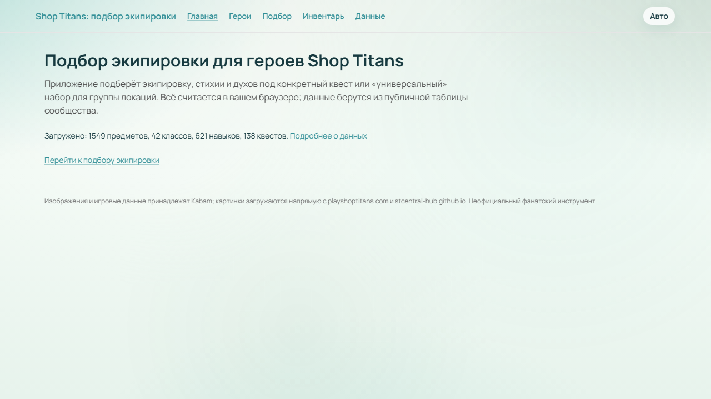
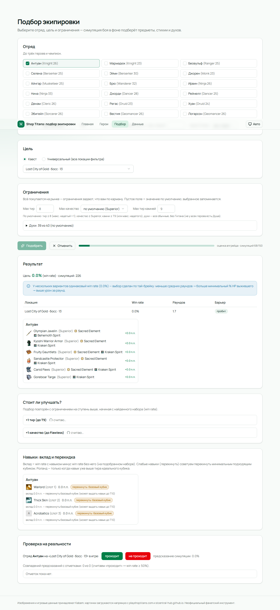
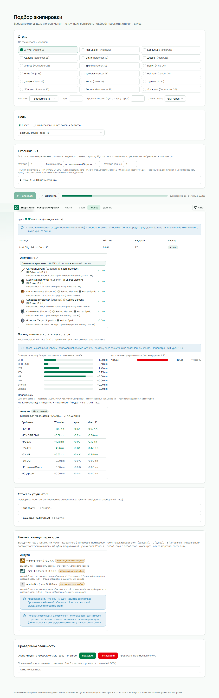
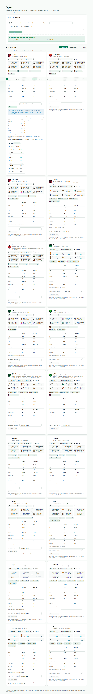
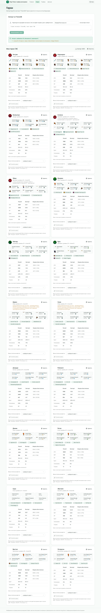
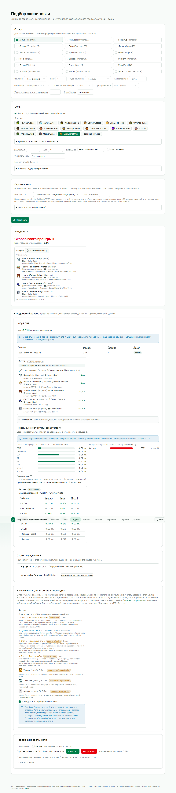
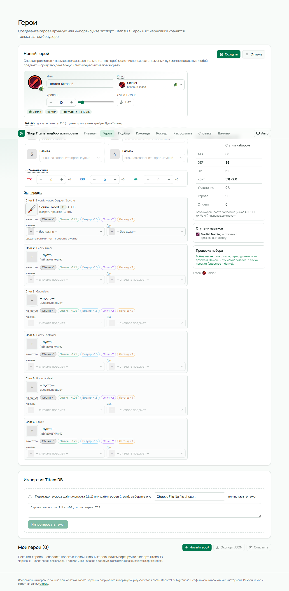
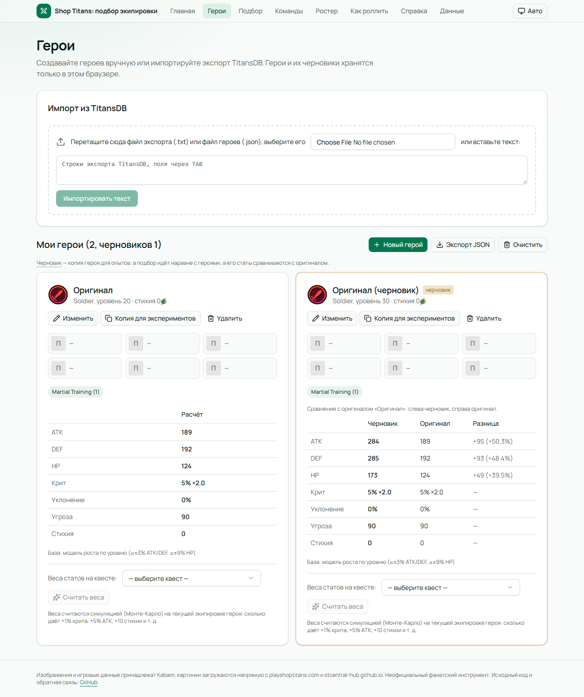
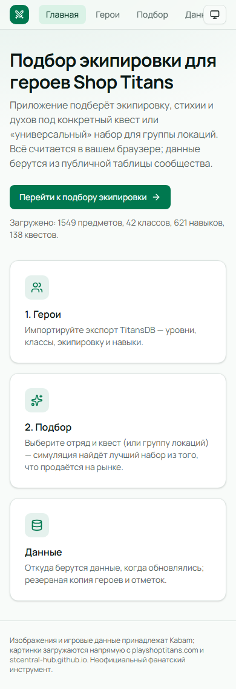
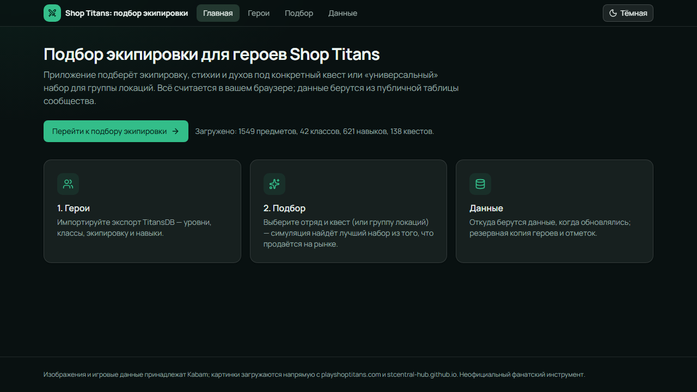

# Shop Titans Gear Optimizer

Браузерное приложение подбирает экипировку, камни (стихии) и духов героям Shop Titans:

1. **под конкретную локацию** (квест + сложность) — с учётом урона босса, порогов защиты и стихийного барьера;
2. **универсальный набор** — лучший в среднем по выбранной группе локаций (или по худшей — режим `robust`).

Всё считается в браузере: сервера, API-ключей и прокси нет. Результат сборки — статичные файлы в `dist/` (GitHub Pages).
Данные пользователя (герои, отметки, выбранные ограничения подбора) живут только в его браузере (IndexedDB) + экспорт/импорт JSON.

**Сайт:** https://keliqq.github.io/STGO/
URL появится в окружении `github-pages` в разделе Deploy репозитория).

## Что умеет

- **«Данные»** — статус кэша (дата, источник), кнопка «Обновить данные сейчас», diff последнего обновления,
  список отказов разбора (rejects) и предупреждений, пороги защиты квестов со stcentral-hub;
  **резервная копия** — экспорт/импорт JSON (герои + отметки «проходит / не проходит»);
  **точность модели** — по накопленным отметкам: сколько боёв отмечено, сколько предсказаний совпало
  (при пороге win rate 50 %) и дата калибровки; отметки, сделанные до текущей версии модели боя, помечаются.
  Полный разбор — `npm run calibrate` (см. ниже).
- **«Герои»** — создание героя вручную («Новый герой») и правка существующего: имя, класс (базовый или
  промоушен), уровень, Душа Титана, семена, до четырёх навыков и шесть слотов экипировки. В списках — только
  то, что герой может использовать: тип по слоту класса, тир не выше потолка уровня (HERO LEVELS, рядом
  подпись «носит до T{N}»), один артефакт на героя, камень и дух — по предмету, навыки — по классу и
  блокировкам A40. Статы пересчитываются в форме сразу. Плюс импорт героев из экспорта TitansDB (файл /
  перетаскивание / вставка), **черновики** («Копия для экспериментов» — дубликат для опытов со сравнением
  статов с оригиналом) и карточка героя: статы (с разбивкой вклада), текущий набор, навыки со ступенью.
- **«Подбор»** — отряд до 3 героев + чемпион (ранг), режим «локация» или «универсальный».
  Инвентаря нет: всё покупается на рынке, пул — любые предметы таблицы, а «по карману» задают ограничения.
  По умолчанию: **макс. тир = макс. тир, надетый у ЭТОГО героя, + 1** (у каждого героя свой потолок, чтобы
  слабому не предлагались вещи под сильного), качество ≤ Superior, камни ≤ T9 (или максимум надетого
  у него), духи — все, кроме Титана, если не у всех героев есть Душа Титана. Любое поле можно поменять —
  выбранные значения запоминаются (кнопка «По умолчанию» сбрасывает), а введённое вручную значение
  работает как общий потолок для всех.
- **Почему именно эти вещи** — у каждого изменённого слота есть строка «почему»: какой стат дала замена
  (`+1682 ATK, +5% CRIT`) и что стало хуже (`минус: −399 DEF`). Ниже — блок **«Веса статов»**: симуляция
  измеряет, что даёт герою `+1% крита`, `+10% урона крита`, `+1% уклонения`, `+5% ATK/HP/DEF`, `+10 стихии`
  и `+10 угрозы` на этом квесте (все варианты на общем seed, поэтому разница не шум), и показывает фразу
  «Главное для героя: …» + столбики по отряду. Там же — **доли атак босса** по каждому бойцу (с
  предупреждением, если ДД получает больше танка), вклад каждого героя в **стихийный барьер** квеста
  (сколько и какой стихии не хватает) и **совет по семенам** (какой тип семян даёт больше на одно семя).
  На карточке героя («Герои») веса можно посчитать для любого квеста отдельной кнопкой. В результате —
  «сейчас → рекомендация» по слотам с иконками, win rate до/после и прирост к надетому,
  предупреждение о непробитом барьере, отметки «проходит / не проходит в игре» для калибровки.
  Кнопка **«Применить подбор»** записывает набор в героя: черновик правится на месте, обычному герою
  создаётся черновик-копия (оригинал не перезаписывается — иначе терялся бы эталон для сравнения).
  Если у нескольких наборов одинаковый win rate — выбор делается по тай-брейку
  (меньше раундов → больше минимальный % HP выжившего → выше урон/раунд), и UI это показывает.
  Блок **«Стоит ли улучшать?»** — насколько вырос бы win rate при +1 тире и при +1 качестве
  (подбор повторяется с ограничением на ступень выше от найденного набора) и какие слоты стоит менять;
  прирост < 1 п.п. помечается «в пределах шума — можно не тратиться».
- **«Навыки»** (в результатах подбора) — вклад каждого навыка в win rate (сравнение с «пустым» слотом)
  и совет, каким кубиком перекидывать: базовый роллит слот 1, супер — 1–2, мега — 1–3, идеальный — 1–4
  (стоимость 1/2/4/8 базовых — подтверждено ST-Central); учитываются блокировки: одна иконка —
  взаимоисключение, на оружие — не больше одного общего и одного эпического навыка (обычный + эпический
  вместе можно). Отдельно — «проверка одним кубиком» для сомнительного героя и совет приберечь Роланда
  (любой навык в любой слот, один раз на героя) на слот 3.
- **Особенности классов и чемпионов** учитываются у всех 42 классов и 13 чемпионов (см. `npm run model-report`
  и docs/PROGRESS.md): эскалация по HP, казнь цели, вторая попытка, DEF щита в ATK, дренаж, возврат бонусов,
  «Any»-стихия против барьера и др. Где класс смоделирован частично, у героя в UI есть пометка
  «оценка приблизительная: не учтено …»; где есть допущения — «учтено с допущениями».
  Флаг «Душа Титана» включает бонусы промоушена (статы, слоты, 4-я ступень врождённого навыка).
- **Офлайн** — приложение открывается без сети: в бандл кладётся снапшот данных (`snapshot.json`),
  плюс PWA (манифест + service worker кэширует статику после первого визита).

## Скриншоты

| Главная                           | Подбор (результат)                          |
| --------------------------------- | ------------------------------------------- |
|  |  |

| Веса статов: почему эти статы                     | Веса статов на карточке героя                         |
| ------------------------------------------------- | ----------------------------------------------------- |
|  |  |

| Герои (импорт фикстуры)                    | Стоит ли улучшать?                            |
| ------------------------------------------ | --------------------------------------------- |
|  |  |

| Форма героя: создание и правка                      | Черновик: сравнение с оригиналом                   |
| --------------------------------------------------- | -------------------------------------------------- |
|  |  |

| Мобильная вёрстка (390 px)                 | Тёмная тема                                |
| ------------------------------------------ | ------------------------------------------ |
|  |  |

Полный набор — в `docs/screens/` (генерируются e2e-тестами: `npm run test:e2e`).

## Как пользоваться

1. Откройте приложение, дождитесь загрузки данных (страница «Данные»).
2. На «Героях» создайте героя кнопкой «Новый герой» или импортируйте экспорт из TitansDB (файл `.txt`,
   перетаскивание или вставка текста). Правка — кнопкой «Изменить», опыты без риска — «Копия для экспериментов».
3. На «Подборе» выберите отряд и цель; при желании поправьте ограничения (по умолчанию — от надетого) →
   «Подобрать». Расчёт идёт в Web Worker, есть прогресс и отмена; результаты кэшируются по хешу входа.
   Ниже результата — оценка «+1 тир / +1 качество»: стоит ли тратиться на апгрейд.
   Понравившийся набор записывается в героя кнопкой «Применить подбор».
4. Отмечайте «проходит / не проходит» на реальных квестах — приложение копит статистику совпадений
   предсказаний с игрой.
5. Резервная копия героев и отметок — на странице «Данные» (экспорт/импорт JSON).

## Как обновляются данные

- Источник — публичная [таблица сообщества](https://docs.google.com/spreadsheets/d/1WLa7X8h3O0-aGKxeAlCL7bnN8-FhGd3t7pz2RCzSg8c)
  (листы BLUEPRINTS, QUESTS, HEROES, SKILLS и др., см. `docs/SCHEMA.md`).
- При старте приложение берёт кэш из IndexedDB; если он старше 24 ч (настраивается) — фоном перечитывает
  листы, валидирует схему и показывает «Данные обновлены: +N предметов, изменено M».
- Если таблица недоступна или её структура изменилась — работаем на последнем рабочем кэше с предупреждением.
- Первый запуск без сети — на снапшоте `src/data/snapshot.json`, который генерируется при сборке
  (`npm run build`); если и таблица, и сеть недоступны — из фикстур `fixtures/sheets/`.
- Пороги защиты квестов — [STC Hub — Main Quests](https://stcentral-hub.github.io/posts/main-quests/)
  (CC BY-NC-ND 4.0): только в рантайме, в репозиторий не входят.

## Ограничения точности

- Формулы боя — по Combat Compendium STC; неподтвержденные моменты помечены `// ASSUMPTION:` в коде
  и собраны в `docs/ASSUMPTIONS.md` (всего A1–A56).
- Статы «голых» героев по уровням — усреднённая модель (HP ±10%, до 26% на отдельных героях);
  для импортированных героев база берётся из эталона экспорта, пока уровень не менялся.
- Симуляция — Монте-Карло: win rate имеет шум ~1 п.п. на 2000 прогонов; сравнение кандидатов и веса
  статов считаются на общих seed (CRN), чтобы шум не решал исход.
- **Веса статов** на непроходимых квестах (win rate 0 %) измеряются на ослабленном «зонде» — иначе
  любая прибавка стата не меняет исход; это эвристика, и UI это помечает (A56).
- Прибавка за одно семя силы — параметр `SEED_STAT_PER_SEED` (A55): колонки семян в экспорте TitansDB
  у фикстуры нулевые, игровых данных о величине нет.
- Не смоделированы: Break Chance, мини-боссы, часть врождённых/лидерских навыков (A36).
- **Калибровка по игре** (`npm run calibrate`, A57/A58): отметки — единственный внешний сигнал о точности
  модели. Пока их нет, точность неизвестна; после накопления отчёт даёт долю верных (порог win rate 50 %),
  Brier score, разрезы ошибок по классу/квесту/сложности/экстриму/барьеру и подгонку 2–3 самых влиятельных
  допущений (сверку статов по `fixtures/heroes.txt` подгонка ломать не имеет права). Выигрыш на десятках
  боёв — не гарантия на новых, поэтому параметров мало и результат пишется в отчёт, а не в константы.
- Итоговая проверка на фикстуре — `docs/REPORT.md` (там же веса, доли атак и «почему» по слотам).

## Команды

```bash
npm install
npm run dev              # dev-сервер (снапшот данных создаётся из фикстур, если его нет)
npm test                 # Vitest (движок, парсеры, хранилища)
npm run test:e2e         # Playwright: собранный dist в живом Chromium (скриншоты в docs/screens)
npm run lint && npm run typecheck
npm run build            # карта картинок (если старше 7 дн.) → снапшот из живой таблицы → vite build
npm run build-snapshot   # src/data/snapshot.json (флаг --offline — из fixtures/sheets)
npm run build-image-map  # src/data/imageMap.json (имя → id картинки)
npm run dump-sheets      # обновить fixtures/sheets
npm run calibrate        # отчёт по отметкам «проходит / не проходит» → docs/CALIBRATION.md
```

### Калибровка по отметкам

1. Отметьте бои в игре на «Подборе» (кнопки «проходит» / «не проходит» — рядом показано предсказание симуляции).
2. На «Данных» посмотрите блок «Точность модели». Для полного разбора нажмите «Экспорт JSON» (кнопка в блоке
   «Резервная копия» — это один файл со всем: герои и отметки; отдельного экспорта только отметок нет).
3. Положите файл как `fixtures/reality.json` и запустите `npm run calibrate` — отчёт появится в
   `docs/CALIBRATION.md`. Полезные флаги: `--file <путь>`, `--runs <прогонов>`, `--no-tune` (только метрики),
   `--max-knobs <2–3>`, `--no-reference` (считать базу статов моделью, а не эталоном экспорта).

Деплой — GitHub Actions (`.github/workflows/deploy.yml`): сборка и публикация `dist/` на GitHub Pages
при пуше в `master`.

## Права на изображения

Все изображения из игры (предметы, духи, стихии, типы, навыки, классы) принадлежат **Kabam**.
Приложение не хранит их копий: картинки загружается напрямую с playshoptitans.com и
stcentral-hub.github.io (fankit) по ссылкам. В репозитории лежит только соответствие
«название → внутренний id» (`src/data/imageMap.json`).

## Лицензия

Код открыт, но **не свободный** в смысле OSI: [Elastic License 2.0](LICENSE) (SPDX `Elastic-2.0`) —
это *source-available* лицензия. Исходники можно читать, форкать и менять, но развернуть из них
публичный сайт для других — нельзя.

**Можно:**

- читать, изучать и копировать исходники;
- форкать, менять и собирать под себя, запускать локально;
- пользоваться как угодно для себя и внутри своей компании (в том числе производственно);
- распространять исходники и свои модификации — но вместе с текстом лицензии, с сохранённым copyright
  и с пометкой, что код изменён.

**Нельзя:**

- выкладывать приложение (или его копию, форк, зеркало) как hosted/managed-сервис для третьих лиц —
  публичный деплой STGO на GitHub Pages, Netlify, Vercel, своём сервере и т. п. `dist/` для всех
  желающих нарушает лицензию (приватный деплой для себя — можно);
- убирать или прятать copyright и уведомления о лицензии;
- выдавать свой форк за оригинал: лицензия даёт права на код, но не на название и оформление STGO.
  Делаешь публичный форк — переименуй проект и убери ссылки на оригинал.

PR в этот репозиторий: отправляя правку, ты соглашаешься, что она распространяется под этой же лицензией.

Лицензия — не техническая защита (статичный сайт всё равно скачивается в браузер), а юридическое
основание: нарушение можно снять жалобой в GitHub или DMCA. Лицензия покрывает только код:
изображения принадлежат Kabam, пороги квестов — STC Hub под CC BY-NC-ND 4.0 (см. «Права на
изображения» выше и `docs/ASSUMPTIONS.md`, A10), поэтому переиспользовать их в своём проекте нельзя.

Неофициальный фанатский инструмент, не связан с Kabam.
